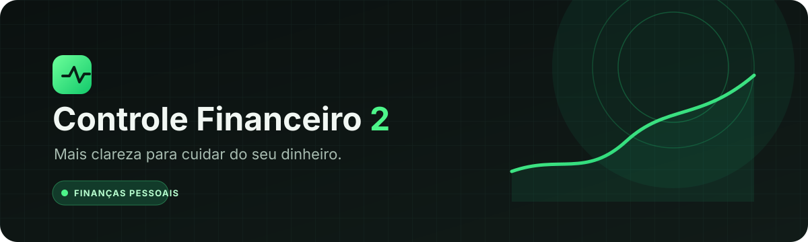
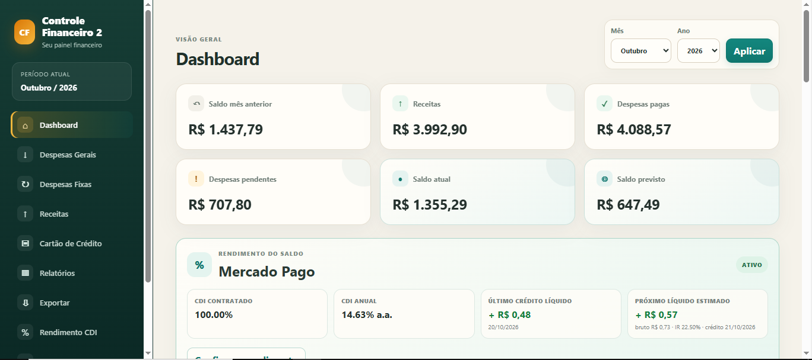
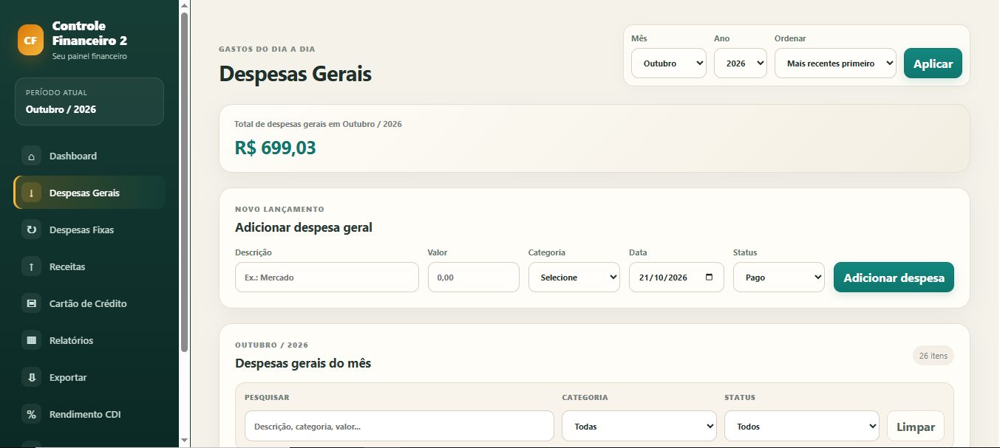
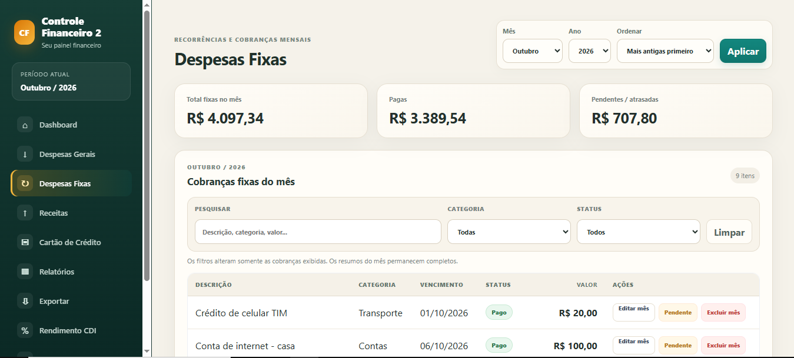
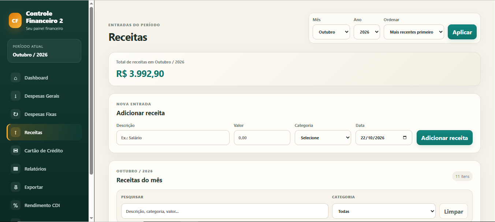
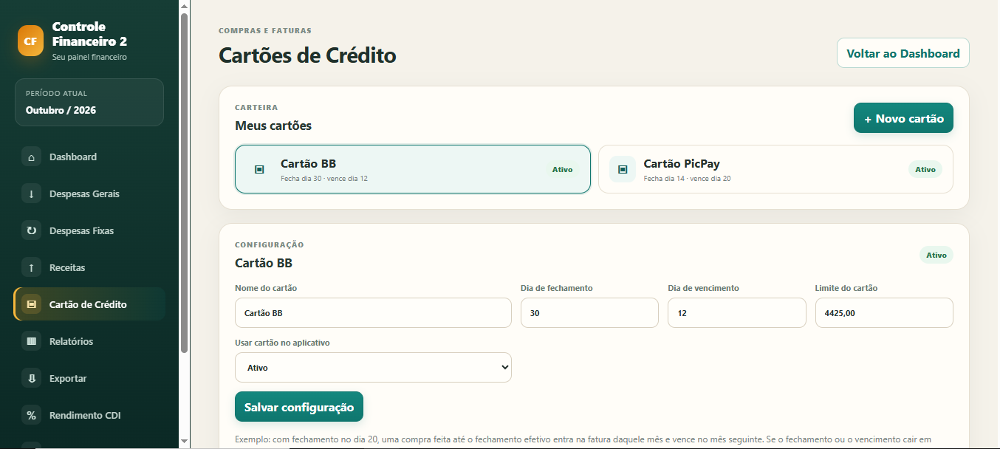
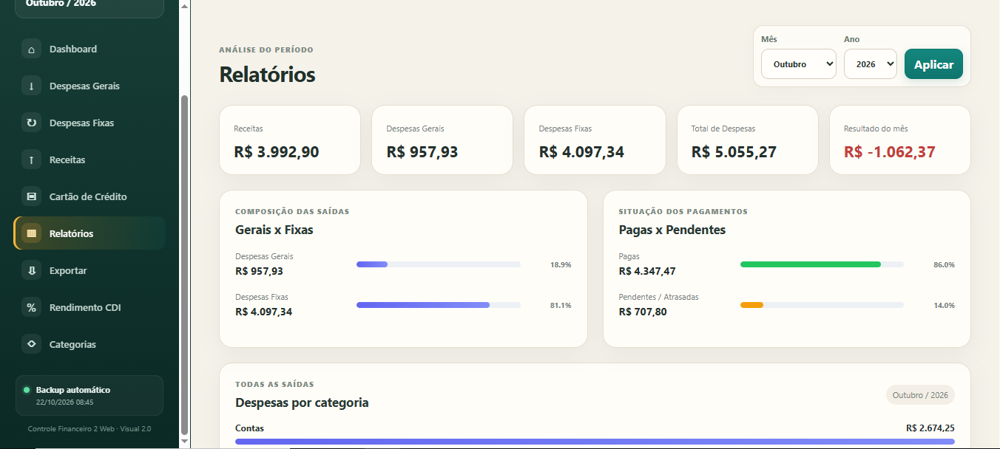
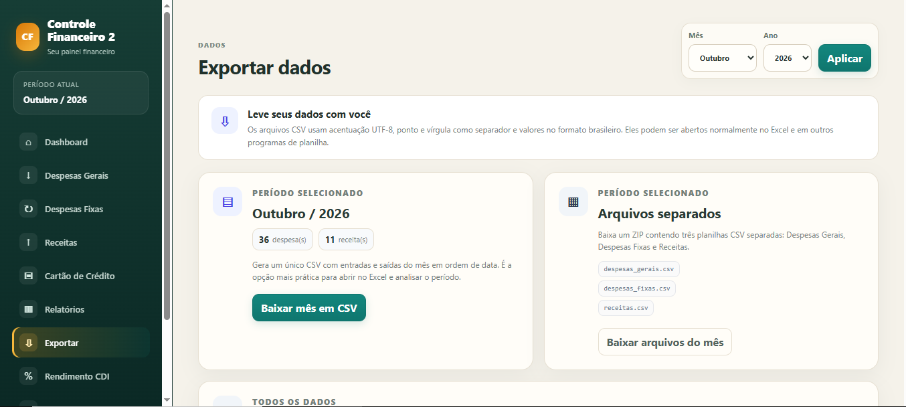
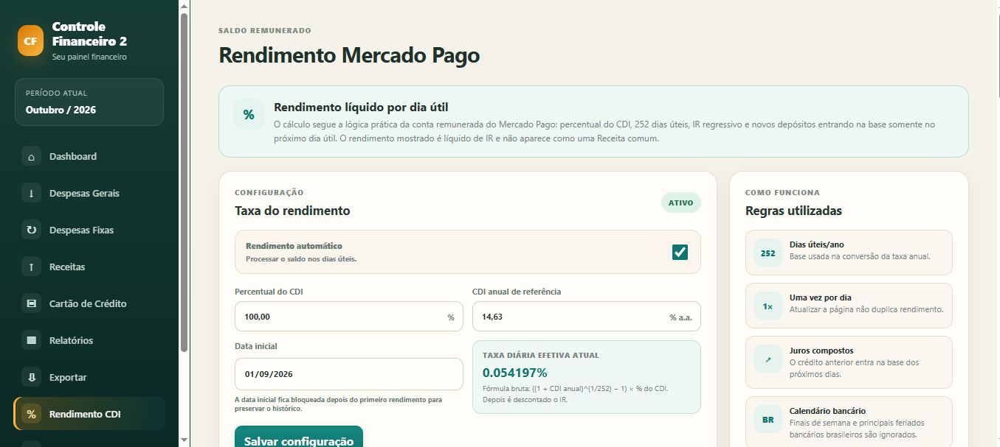
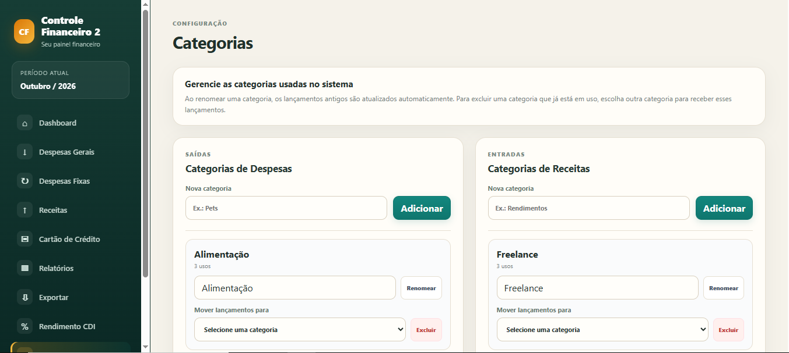

<h1 align="center">Controle Financeiro 2</h1>

<p align="center">
  <strong>Mais clareza para cuidar do seu dinheiro.</strong><br>
  Organize receitas, despesas, cartões e rendimentos em um só lugar.
</p>

<p align="center">
  
  
  
  
</p>

---

## ✦ Sobre o projeto

O **Controle Financeiro 2** é uma aplicação web para acompanhar a vida financeira com mais organização e praticidade. Reúne lançamentos, despesas recorrentes, cartões de crédito e estimativas de rendimento em uma interface acessível pelo navegador.

O projeto foi desenvolvido com foco em uso pessoal, persistência local dos dados e possibilidade de execução em contêiner.

## Recursos

| Recurso | O que oferece |
| --- | --- |
| **Receitas e despesas** | Registre e acompanhe entradas e saídas financeiras. |
| **Despesas recorrentes** | Organize compromissos fixos e cobranças periódicas. |
| **Categorias e relatórios** | Separe movimentações por categoria e consulte os resultados. |
| **Cartões de crédito** | Gerencie múltiplos cartões, faturas, compras à vista e parceladas e cobranças recorrentes. |
| **Estimativa de rendimento** | Acompanhe simulações baseadas em percentual do CDI, com processamento de dias úteis e estimativa de imposto de renda. |
| **Exportação e backups** | Exporte informações e mantenha cópias de segurança do banco local. |
| **Interface responsiva** | Acesse pelo computador ou por dispositivos móveis. |

## Prévia visual

### Dashboard

<p align="center">
  
</p>

### Despesas gerais

<p align="center">
  
</p>

### Despesas fixas

<p align="center">
  
</p>

### Receitas

<p align="center">
  
</p>

### Cartão de crédito

<p align="center">
  
</p>

### Relatórios

<p align="center">
  
</p>

### Exportar

<p align="center">
  
</p>

### Rendimento CDI

<p align="center">
  
</p>

### Categorias

<p align="center">
  
</p>

## Tecnologias

- **Backend:** Python e Flask
- **Banco de dados:** SQLite
- **Interface:** HTML, CSS e JavaScript
- **Execução:** Docker e Docker Compose
- **Calendário financeiro:** biblioteca Python `holidays`

## Executar com Docker Compose

### Requisitos

- Docker
- Docker Compose

### 1. Baixe o projeto

```bash
git clone https://github.com/Jhonata830/controle-financeiro-completo.git
cd controle-financeiro-completo
```

### 2. Configure o ambiente

Copie o arquivo de exemplo e defina uma chave secreta forte e exclusiva no arquivo `.env`:

```bash
cp .env.example .env
```

No Windows, você também pode copiar `.env.example` para `.env` pelo Explorador de Arquivos e editar o arquivo com um editor de texto.

**Nunca publique o arquivo `.env` nem compartilhe sua chave secreta.**

### 3. Inicie a aplicação

```bash
docker compose up -d --build
```

### 4. Acesse

Abra [http://localhost:5051](http://localhost:5051) no navegador.

Os dados persistentes ficam nas pastas locais `dados/` e `backups/`, mapeadas para o contêiner. Não apague nem substitua o banco de dados para atualizar a aplicação sem antes fazer uma cópia de segurança.

## Executar localmente com Python

Requer Python 3.11 ou superior.

```bash
python -m venv .venv
```

Ative o ambiente virtual:

```powershell
# Windows PowerShell
.venv\Scripts\Activate.ps1
```

```bash
# Linux / macOS
source .venv/bin/activate
```

Instale as dependências e execute:

```bash
python -m pip install -r requirements.txt
python app.py
```

Depois, abra no navegador o endereço local indicado pelo Flask. Para uso contínuo ou acessível pela rede, configure uma chave secreta segura e utilize uma configuração de servidor apropriada.

## Privacidade e segurança

- O banco de dados e os backups contêm informações financeiras pessoais: mantenha-os protegidos.
- Não envie ao GitHub bancos reais, arquivos de backup, senhas, tokens, arquivos `.env`, IPs privados ou configurações pessoais de rede.
- Defina uma `SECRET_KEY` forte por variável de ambiente antes de utilizar a aplicação em um ambiente real.
- Faça backups antes de atualizar a aplicação ou modificar arquivos de dados.

## Sobre os rendimentos

Os valores de rendimento apresentados pela aplicação são **estimativas para acompanhamento pessoal**. Não representam uma integração oficial com um banco ou instituição financeira, nem garantem rentabilidade.

As regras de remuneração, datas de crédito, percentual aplicado ao CDI, tributação, arredondamentos e condições de cada produto podem variar entre instituições e ao longo do tempo. Confira sempre os extratos e as condições oficiais da instituição utilizada. O recurso não substitui orientação financeira ou tributária.

## Estrutura principal

```text
controle-financeiro-completo/
├── assets/                       # Identidade visual e imagens do projeto
├── templates/                    # Páginas HTML
├── static/                       # CSS, JavaScript e recursos estáticos
├── dados/                        # Banco local (não publicar dados reais)
├── backups/                      # Cópias de segurança (não publicar)
├── app.py                        # Aplicação e lógica do sistema
├── Dockerfile                    # Imagem Docker
├── docker-compose.yml            # Configuração dos serviços
├── requirements.txt              # Dependências Python
└── README.md                     # Documentação do projeto
```

## Identidade visual

A identidade do repositório utiliza uma base grafite escura e verde vibrante para transmitir clareza, foco e organização. O banner está em `assets/banner-controle-financeiro.svg`.

## Licença

Este repositório ainda não declara uma licença de código aberto. Até que uma licença seja adicionada, não presuma que o código pode ser reutilizado, redistribuído ou modificado livremente.

---

<p align="center">
  Feito para trazer mais clareza à organização financeira pessoal.
</p>
